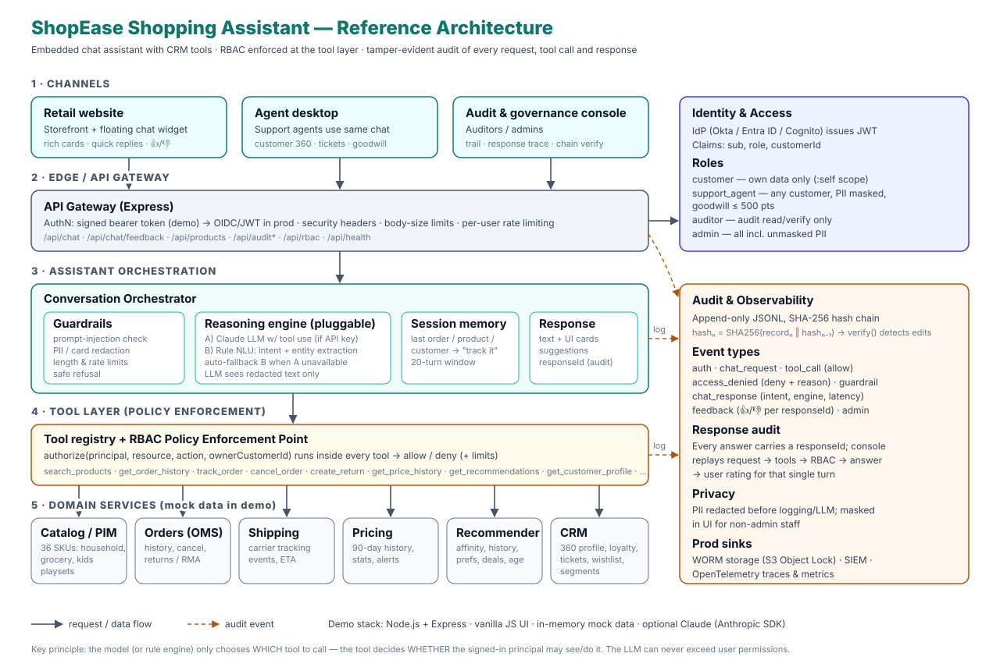
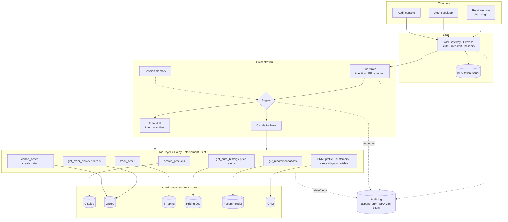
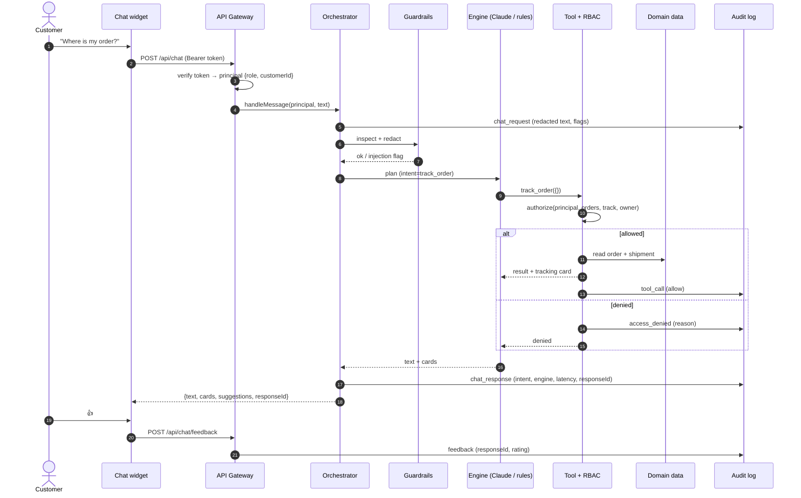
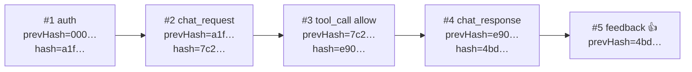

# Architecture — ShopEase Shopping Assistant

## 1. Goals

| Goal | How it is met |
|---|---|
| Conversational self‑service inside the retailer site | Floating chat widget with rich cards (orders, tracking timeline, price chart, CRM 360) |
| CRM capabilities for staff | Same assistant serves support agents (customer search, 360 profile, tickets, goodwill points) |
| **Least privilege** | RBAC is enforced in the **tool layer**: every tool calls `authorize()` before reading or writing data |
| **Accountability** | Every request, tool call, permission decision, response and user rating is written to a **hash-chained audit log** |
| LLM‑ready but not LLM‑dependent | Pluggable engine: Claude with tool use when `ANTHROPIC_API_KEY` is set, deterministic rule NLU otherwise (and as fallback) |

## 2. Components

| Layer | File(s) | Responsibility |
|---|---|---|
| UI | `public/index.html`, `app.js`, `cards.js` | Storefront, chat widget, card renderers, feedback buttons |
| Audit console | `public/admin.html`, `admin.js` | Audit trail, response trace, chain verification, RBAC matrix |
| Gateway | `server/index.js` | REST API, authN middleware, `requirePerm` for admin APIs |
| Auth | `server/security/auth.js` | HMAC‑signed bearer token (demo stand‑in for OIDC JWT) |
| RBAC | `server/security/rbac.js` | Role → permission map, `authorize()` with `:self` / `:any` scopes, per-role limits |
| Guardrails | `server/security/guardrails.js` | Prompt‑injection detection, card/email/phone redaction, rate limiting |
| Orchestrator | `server/assistant/orchestrator.js` | Turn handling, engine selection, tool execution, audit hooks |
| NLU | `server/assistant/nlu.js` | Intent classification + entity extraction (order ID, SKU, customer, price, dates) |
| LLM | `server/assistant/llm.js` | Claude tool‑use loop over the same tool registry |
| Tools | `server/services/tools.js` | Business capabilities; each one authorises the caller |
| Data | `server/data/seed.js`, `server/services/store.js` | Deterministic mock data and search |
| Audit | `server/audit/auditLog.js` | Hash‑chained JSONL log, query, stats, verify |

## 3. Request flow (one chat turn)

## 4. RBAC model

Permissions are `resource:action[:scope]`.  `:self` means only resources whose `customerId` matches the principal; `:any` means all customers.

| Permission | Customer | Support agent | Auditor | Admin |
|---|:-:|:-:|:-:|:-:|
| catalog:read, pricehistory:read, recommendations:read | ✓ | ✓ | ✓ (catalog/price) | ✓ |
| orders:read / track / cancel | self | any | ✗ | ✓ |
| returns:create | self | any | ✗ | ✓ |
| profile:read | self | any (**PII masked**) | ✗ | ✓ (unmasked) |
| customers:search | ✗ | ✓ | ✗ | ✓ |
| tickets:create / read | self | any | ✗ | ✓ |
| loyalty:adjust | ✗ | ✓ (≤ 500 pts) | ✗ | ✓ (≤ 10,000) |
| wishlist / price alerts | self | ✗ | ✗ | ✓ |
| audit:read / audit:verify | ✗ | ✗ | ✓ | ✓ |
| feedback:create | ✓ | ✓ | ✗ | ✓ |

Design decisions:

* **Enforcement point is the tool, not the prompt.** The LLM decides *which* tool to call; the tool decides *whether* the signed‑in principal may do it. Prompt injection therefore cannot escalate privileges.
* **Customer identity comes from the token**, never from the message. A customer who types another customer's ID is denied and the attempt is audited.
* **Limits** (e.g. goodwill points) are part of the role definition, so policy changes don't require code changes.
* **PII masking** is applied per role in the data returned by tools, so masked data never reaches the LLM context or UI for staff without the right.

## 5. Audit design

* **Append‑only JSONL** (`logs/audit.jsonl`); each record = `{seq, id, ts, type, actor, role, sessionId, responseId, action, resource, decision, reason, details, prevHash, hash}`.
* `hash = SHA‑256(record without hash)` and includes `prevHash`, so editing or deleting any record breaks every later link. `GET /api/audit/verify` recomputes the chain. The console has a **Simulate tampering** button (admin) to show detection live.
* **Response audit:** every assistant answer carries a `responseId`. The console reconstructs the full turn — request → tool calls with RBAC decisions → response text/intent/engine/latency → user 👍/👎.
* **Redaction before write:** card numbers, emails and phone numbers are masked in all audit details.
* **Auditing the auditors:** viewing the audit trail is itself an audited `admin` event; denied attempts to open it are `access_denied` events.

## 6. Feature → tool map

| User capability | Tool | Notes |
|---|---|---|
| Search products | `search_products` | keyword relevance over name/brand/tags; category & max price filters |
| Order history | `get_order_history` | filters: category, status, last N days, product |
| Track order | `track_order` | carrier, tracking #, ETA, event timeline; defaults to latest open order |
| Cancel / return | `cancel_order`, `create_return` | business rules: only Processing can be cancelled; returns ≤ 30 days after delivery |
| Price history (90 days) | `get_price_history` | min/max/avg, 30‑day change, buy/wait verdict, interactive SVG chart |
| Price alerts / wishlist | `create_price_alert`, `manage_wishlist` | |
| Recommendations | `get_recommendations` | blended score: frequently‑bought‑together, purchase history, preferences, wishlist, kids' ages, 90‑day lows, replenishment |
| CRM 360 | `get_customer_profile`, `search_customers` | tier, points, LTV, segments, preferences, open tickets |
| Support | `create_support_ticket`, `list_support_tickets`, `adjust_loyalty_points` | |

## 7. Production hardening roadmap

| Area | Demo | Production |
|---|---|---|
| Identity | HMAC demo token, user picker | OIDC/SAML SSO (customer CIAM + workforce IdP), short‑lived JWT, MFA for staff |
| Policy | In‑code role map | OPA / Cedar policies, ABAC (region, store, ticket assignment), JIT elevation for PII |
| Data | In‑memory mock | OMS, PIM, CRM (e.g. Salesforce/Dynamics), carrier APIs via adapters; pricing history in a time‑series store |
| Assistant | Rules + optional Claude | Claude with tool use, prompt caching, eval suite for intents & safety, human hand‑off |
| Audit | Local JSONL + hash chain | Kafka → WORM object storage (S3 Object Lock), SIEM, periodic anchored chain head, retention policies |
| Observability | latency in audit | OpenTelemetry traces, dashboards for containment rate, CSAT (👍/👎), deflection |
| Scale | Single Node process | Stateless containers behind LB, Redis session memory, rate limiting at API gateway / WAF |
| Compliance | PII redaction | GDPR/CCPA DSAR export & delete, PCI scope reduction (no card data in chat), consent‑aware recommendations |
